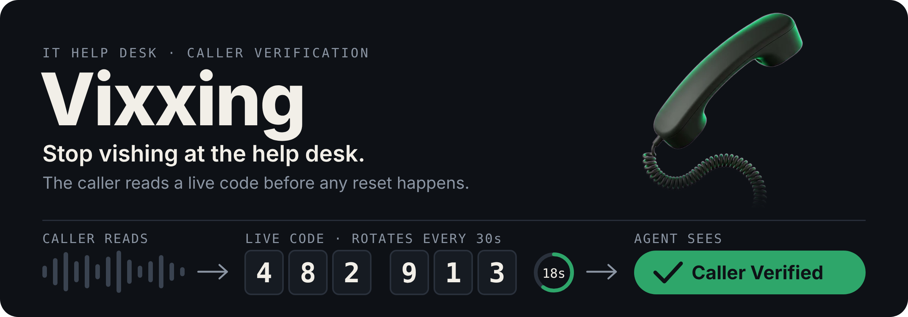
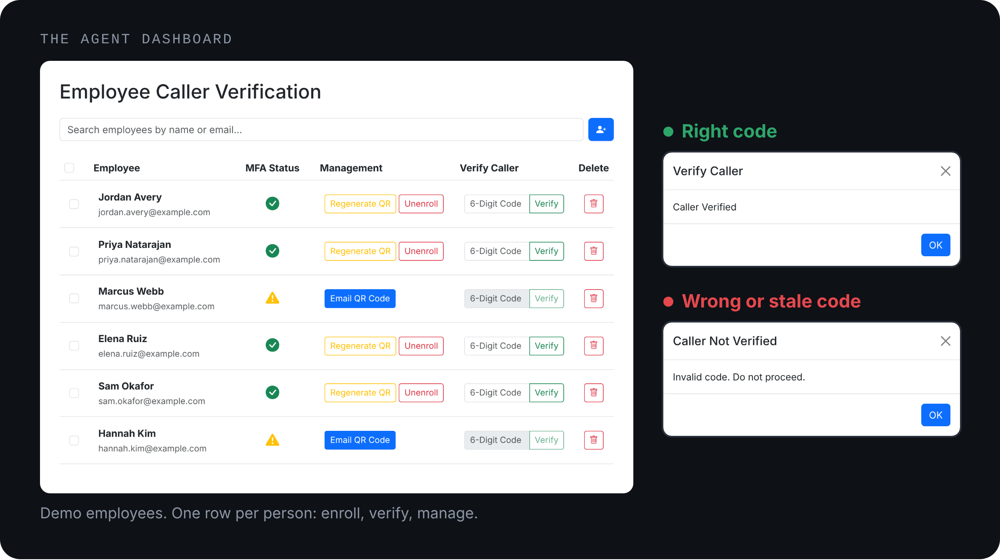
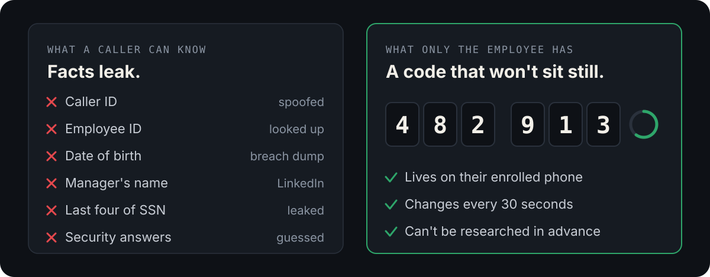
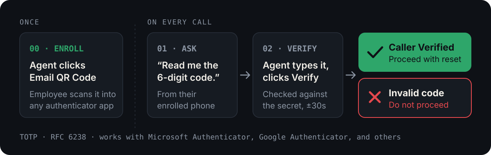

<p align="center">
  
</p>

**Vixxing** is a caller-verification tool for IT help desks. Before an agent
resets a password or MFA, the caller reads the current 6-digit code from their
authenticator app, and the agent clicks **Verify**. If the code is right, they
proceed. If not, they don't.

The name is a nod to the problem it solves: **vishing** (voice phishing), where
an attacker calls the help desk, impersonates a real employee, and talks an
agent into resetting their credentials.

<p align="center">
  
</p>

---

## Your help desk is an authentication bypass

Most account-takeover defenses assume the attack comes through a login screen.
The help desk is a different door, and it is usually a weaker one. A typical
vishing call:

1. The attacker researches an employee (LinkedIn, a breach dump, the company
   directory) until they can sound legitimate.
2. They call: *"Hi, this is Jordan from Accounting. I got a new phone and I'm
   locked out — can you reset my MFA?"*
3. The agent checks caller ID, an employee ID, a date of birth, a manager's
   name, or security questions.
4. Under time pressure and a friendly tone, the agent resets the account. The
   attacker now owns it.

<p align="center">
  
</p>

None of those checks prove *possession of anything*; they prove the caller knows
facts, and facts leak. Vixxing puts a **possession factor on the phone call
itself**: a caller who cannot read a live, rotating code from the enrolled
device is not the employee, no matter how much background detail they recite.

It uses TOTP (RFC 6238), the same standard as login MFA, so "read me the
6-digit code" is a familiar, few-second ask.

## How it works

<p align="center">
  
</p>

### Enrollment (once per employee)

1. An agent adds the employee (first name, last name, email) on the dashboard,
   or the employee already exists in the **Employees** group.
2. The agent clicks **Email QR Code**. The server generates a random base32
   TOTP secret with [PyOTP](https://github.com/pyauth/pyotp), builds an
   `otpauth://` provisioning URI, renders it as a QR code, and emails it to the
   employee — inline and attached as `enrollment_qr.png`.
3. The employee scans it with Microsoft Authenticator, Google Authenticator, or
   any RFC 6238 app. Their app now shows a 6-digit code that rotates every 30
   seconds.

The secret lives on the employee's phone and in the Vixxing database, where it
is **not encrypted** beyond whatever protection your database and host provide.

### Verification (every call)

The agent finds the employee, asks for the current code, types it in, and clicks
**Verify**. The server checks it against the stored secret, accepting the
current 30-second window plus one on either side for clock drift, and answers
**Caller Verified** or **Caller Not Verified — Invalid code. Do not proceed.**

### Management

Every employee row, and the bulk actions for selected rows, support:

- **Regenerate QR** — issues a new secret and re-emails it, invalidating the old
  device. Use it when someone changes phones or a secret may be compromised.
- **Unenroll** — clears the secret but keeps the account, so they can be
  re-enrolled later.
- **Delete** — permanently removes the account and secret.
- **Add Employees** — one at a time, or in bulk from a CSV (requires an `email`
  column; `first_name`/`last_name` optional). Import only creates accounts; it
  never enrolls anyone or sends mail.
- **Export (CSV)** — name, email, username, and enrollment status for everyone
  or the selected rows. Never includes TOTP secrets.
- **Search** — filter by name or email.

Destructive actions go through a confirmation dialog rather than the browser's
native `confirm()`/`alert()` popups.

### Who can use it

Every view is protected by Django's `@staff_member_required`. Help-desk agents
log in as Django **staff** users; the built-in admin at `/admin/` creates those
accounts and manages employees. There is no self-service portal — this is an
internal tool for agents.

---

## Quick start

Requires Python 3.12+ and an email-sending path (Microsoft Graph out of the box,
or any Django email backend — see [Delivery backends](#delivery-backends-and-automatic-fallback)).

```bash
git clone https://github.com/miles-howell/vixxing.git
cd vixxing
python -m venv .venv
source .venv/bin/activate        # Windows: .venv\Scripts\activate
pip install -r requirements.txt

cd TOTP
cp .env.example .env             # then fill it in — see below
python manage.py migrate
python manage.py createsuperuser
python manage.py runserver 0.0.0.0:8000   # bind to the LAN so agents can reach it
```

Log in at `http://<server-ip>:8000/admin/` with the superuser, then open the
dashboard at `http://<server-ip>:8000/` and start adding employees.

For anything longer-lived than a quick test, run it under Gunicorn behind an
internal reverse proxy instead of the dev server.

> [!WARNING]
> **LAN-only by design.** Vixxing is built for a trusted internal network and is
> not hardened for the public internet. Read
> [Scope and security posture](#scope-and-security-posture-lan-only) before
> deploying.

---

## Configuration

### Environment variables

Create `TOTP/.env`. The app reads all of these; the shipped `.env.example` is a
starting point and does not list every one.

| Variable              | Required | What it is                                                                 |
| --------------------- | -------- | -------------------------------------------------------------------------- |
| `SECRET_KEY`          | Yes      | Django secret key. Generate a fresh, random one — do not reuse an example. |
| `ALLOWED_HOSTS`       | Yes      | Hostname/IP the app is served on (Django's `ALLOWED_HOSTS`). One value.    |
| `MSGRAPH_TENANT_ID`   | Graph    | Azure/Entra tenant (directory) ID.                                         |
| `MSGRAPH_CLIENT_ID`   | Graph    | Application (client) ID of your app registration.                          |
| `MSGRAPH_CLIENT_SECRET` | Graph  | Client secret for that app registration.                                   |
| `MSGRAPH_USER_ID`     | Graph    | The mailbox (user ID or UPN) enrollment mail is sent **from**.             |
| `EMAIL_HOST`          | SMTP     | SMTP server hostname. Leave unset to disable the SMTP fallback entirely.   |
| `EMAIL_PORT`          | SMTP     | SMTP port. Defaults to `587`.                                              |
| `EMAIL_HOST_USER`     | SMTP     | SMTP username, if your server requires auth.                               |
| `EMAIL_HOST_PASSWORD` | SMTP     | SMTP password, if your server requires auth.                               |
| `EMAIL_USE_TLS`       | SMTP     | `true`/`false`. Defaults to `true`. Mutually exclusive with `EMAIL_USE_SSL`.|
| `EMAIL_USE_SSL`       | SMTP     | `true`/`false`. Defaults to `false`.                                       |
| `DEFAULT_FROM_EMAIL`  | Yes      | Default From address, used by both Graph and SMTP.                        |

Generate a Django secret key:

```bash
python -c "from django.core.management.utils import get_random_secret_key; print(get_random_secret_key())"
```

### Microsoft Graph credentials (not included)

The app can send enrollment mail through the Microsoft Graph API, but **no
credentials ship in this repo, and none are implied.** Cloning it does not give
anyone access to email or to your directory. To provide your own:

1. In **Microsoft Entra ID** (Azure AD), register an application (it shows up as
   an **Enterprise Application** in your tenant).
2. Grant it the Microsoft Graph **`Mail.Send`** *application* permission and
   have an admin grant tenant-wide consent.
3. Create a **client secret** for the app.
4. Put the **tenant ID, client (application) ID, and client secret** in `.env`,
   and set `MSGRAPH_USER_ID` to the mailbox mail should be sent from.

The application ID and secret are the keys to sending mail as your tenant — they
belong in `.env`, never in version control.

### Delivery backends and automatic fallback

Enrollment mail goes through Django's normal email machinery via
`settings.MAILERS` (`TOTP/TOTP/settings.py`), which defines two named mailers:

1. **`default` (Microsoft Graph API)** — tried first. It authenticates with a
   short-lived OAuth token rather than a standing SMTP password, so it's the
   preferred path when both are available.
2. **`smtp`** — tried automatically if Graph delivery fails for any reason
   (bad or expired credentials, tenant outage, network issue), or if Graph isn't
   configured at all. This mailer only exists when `EMAIL_HOST` is set.

Nothing requires Microsoft Graph. To run SMTP-only, drop the Graph variables and
set the SMTP ones; the `default` mailer will fail immediately and every send
goes straight to SMTP. The dashboard reports which backend actually delivered
each message (and which failed first, if any), so a broken Graph setup doesn't
go unnoticed just because SMTP quietly picked up the slack.

### A few strings are hardcoded — change them for your org

These placeholders live in code, not `.env`, because they are cosmetic. Edit them
before you send real enrollment mail:

- `verify/views.py` — the `from_email`, the TOTP `issuer_name` (shown in the
  authenticator app), and the email subject line.
- `verify/templates/verify/enrollment_email.txt` and `.html` — the message body,
  authenticator-app instructions, and signature.
- The **Employees** group name, if you want to scope the dashboard to a
  different Django group.

### Local secrets and state (git-ignored)

These are excluded by `.gitignore` and created per install:

- `TOTP/.env` — all of the secrets above.
- `db.sqlite3` — the database, including enrolled employees and their TOTP
  secrets.
- `staticfiles/` and other collected static output.

---

## Scope and security posture: LAN-only

**Vixxing is built to run on a trusted internal network. It is not hardened for
the public internet, and you should not expose it there.**

The shipped configuration reflects that intent:

- `SESSION_COOKIE_SECURE = False` and `CSRF_COOKIE_SECURE = False` (no HTTPS
  assumed)

Those cookie settings are convenient during development and unsafe in
production. Before this touches anything beyond a trusted internal segment, at
minimum terminate TLS and turn the secure-cookie flags back on (there's a
commented-out `SECURE_PROXY_SSL_HEADER` in `settings.py` for the reverse-proxy
case), and put it behind proper access controls (VPN, internal reverse proxy,
IP allow-listing).

*Unencrypted MFA secrets are transmitted over the network, as well as over email
unless you force HTTPS and encrypt the emails.* My preferred hosting stack is
NSSM + Caddy on a Windows Server VM, with Exchange mail-flow rules for encrypting
emails (assuming you own the tenant for both the sender and recipient).

---

## Development

### Tech stack

| Piece                 | What it's for                                              |
| --------------------- | ---------------------------------------------------------- |
| Django 6.1            | Web framework, auth, admin, ORM                            |
| PyOTP                 | TOTP secret generation and code verification               |
| qrcode + Pillow       | Rendering enrollment QR codes                              |
| django-msgraphbackend | Sending enrollment email through the Microsoft Graph API   |
| SQLite                | Default datastore (swap for Postgres/MySQL if you prefer)  |
| WhiteNoise            | Serving static files                                       |
| Gunicorn              | WSGI server for anything beyond the dev server             |

### Project layout

```
Vixxing/
├── requirements.txt
├── .github/workflows/        # CI: Django tests + dependency review on PRs
└── TOTP/                     # Django project root (run manage.py from here)
    ├── manage.py
    ├── .env.example          # copy to .env and fill in — see Configuration
    ├── TOTP/                 # settings, URLs, WSGI/ASGI
    └── verify/               # the app: dashboard, enrollment, verification
        ├── models.py         # EmployeeMFA (secret + enrollment flag)
        ├── views.py          # enroll / verify / add / unenroll / delete /
        │                     # CSV import-export / bulk actions / dashboard
        ├── urls.py
        ├── tests.py          # run with `python manage.py test`
        └── templates/verify/ # dashboard + enrollment email templates
```

### Running the tests

```bash
cd TOTP
python manage.py test
```

Tests mock outbound mail, so they never hit the real Microsoft Graph API or an
SMTP server. GitHub Actions runs the same suite on every push and pull request
against `main` (Python 3.12 and 3.13), and a Dependency Review Action flags
known-vulnerable packages introduced by a PR.

---

## License

Vixxing is released under the **GNU General Public License v3.0**. See
[`LICENSE`](LICENSE) for the full text.
